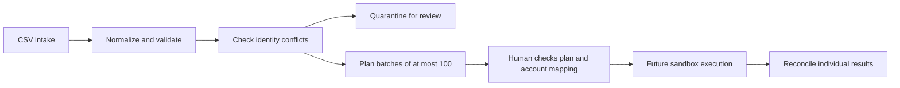

# HubSpot Contact Sync Lab

**CSV-to-CRM planning, identity conflict review, and batch-result reconciliation.**
Independent portfolio lab by Anees Ur Rehman. This is a tested offline implementation,
not evidence of a client HubSpot deployment. No credentials, network calls or CRM writes.

## Run (Python 3.11+, standard library)

```sh
python -m sync_lab plan examples/contacts.csv
python scripts/verify.py
python -m sync_lab reconcile evaluation/plan.json examples/response.json
```

The synthetic sample has six input rows: two contacts are planned, one exact duplicate
is skipped, and three invalid/conflicting rows are quarantined. See the generated
[plan](evaluation/plan.json), [reconciliation](evaluation/reconciliation.json), and
[test results](evaluation/tests.txt). No real client records are included.

## What it demonstrates



- Explicit field allowlist; email normalization and country-code phone validation.
- Exact duplicates skipped; conflicting identities quarantined rather than merged.
- Blank optional fields omitted, so a plan does not request accidental clearing.
- Custom unique-ID upsert contract and deterministic plan hash.
- Conservative reconciliation: pending, incomplete or error responses require review.
- Bounded retry policy for transient HTTP errors; authentication errors are not retried.

## HubSpot mapping and prerequisite

The request contract targets the documented `/crm/v3/objects/contacts/batch/upsert`
endpoint. The account must first contain a unique contact property named
`portfolio_external_id`. Existing contacts need a reviewed mapping/backfill before
sync; assigning new external IDs blindly can still create duplicates in a real account.
The lab deliberately uses a custom unique property because HubSpot's legacy-v3 guide
states that partial upserts by email are not supported. It limits batches to 100.
The API is now documented in HubSpot's legacy section: check current support and the
account's API version before building a live integration.

This is **not** marketing-subscription management. A contact import does not establish
consent or enroll anyone in marketing. No lifecycle-stage, owner, deal, or subscription
changes are made. Email normalization is an illustrative business rule; international
address handling and local-part case policy need explicit decisions before deployment.

## Sandbox handover

See [implementation checklist](docs/SANDBOX.md). A real implementation requires account
access, custom-property creation, least-privilege token setup, an authenticated worker,
secret storage, response persistence, and end-to-end sandbox checks. The supplied retry
function is a policy, not a running network retry worker. Invalid numeric Retry-After
values are rejected; HTTP-date parsing is not implemented.

## Sources

- [Official HubSpot contacts guide](https://developers.hubspot.com/docs/api-reference/legacy/crm/objects/contacts/guide)

Original source and synthetic fixtures under MIT. HubSpot is a third-party platform;
this lab is not affiliated with or endorsed by HubSpot.
